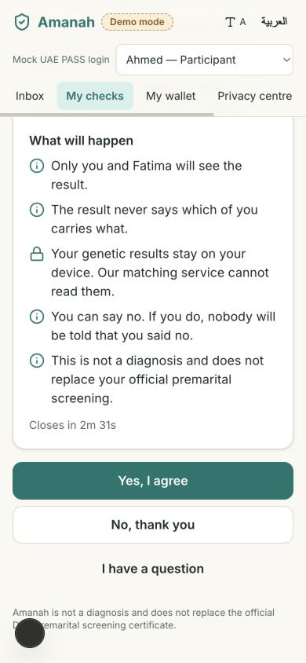
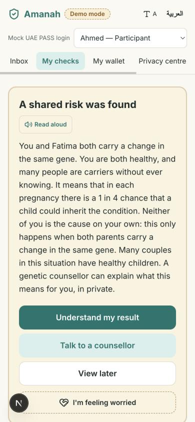
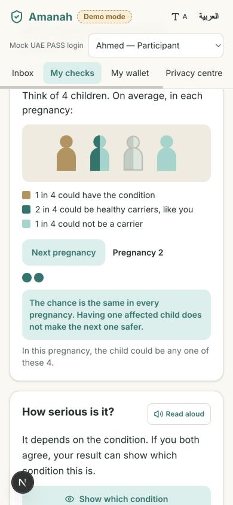
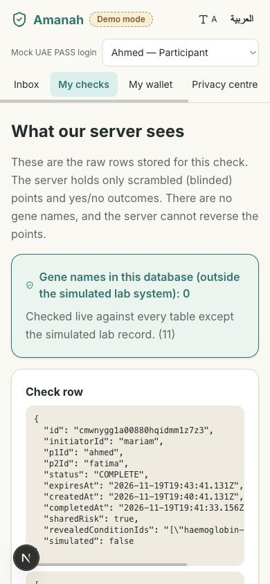
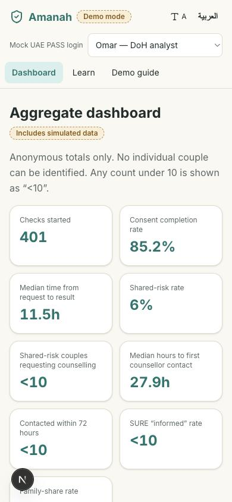
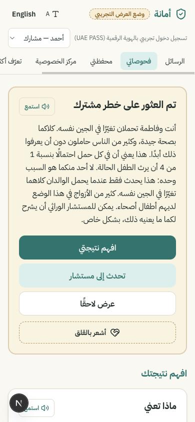

# Amanah — private, consent-based genetic compatibility checks

> Future Health Digital Innovation Challenge (DoH Abu Dhabi × Microsoft × Inception × MBZUAI) — *Understanding and Reducing Inherited Disease Risk* (Fertility).
> **Hackathon prototype. Synthetic data only. Not a diagnosis and not a replacement for the official DoH premarital screening certificate.**

Abu Dhabi's premarital genetic screening (570 genes, 840+ conditions) usually happens late, after families have agreed a proposal, and the UAE has only a handful of genetic counsellors. **Amanah** lets a family start a **private check early in marriage discussions**:

- The **two people being matched each consent individually**. Saying no is invisible: a decline looks exactly like no response.
- Matching uses **private set intersection (PSI) on each person's device**. The server only ever sees blinded ristretto255 points, never gene names.
- The result is binary ("No shared risk found in the genes tested" / "A shared risk was found") and goes **only to the two participants**. It never says who carries what.
- A shared risk opens a calm explainer with an icon array, neutral options, read‑aloud in English and Arabic, and a teach‑back check. It also offers a **one‑tap, SLA‑tracked path to a human genetic counsellor**.
- The condition is revealed only if **both** agree. Families see results only if **both** agree to share.
- The health system sees **only anonymous aggregates** with `<10` suppression. Amanah never alerts any authority about a couple.

| Consent | Shared risk | Icon array | Server view | Dashboard | Arabic (RTL) |
|---|---|---|---|---|---|
|  |  |  |  |  |  |

## Run it

Requires Node ≥ 20.11.

```bash
npm install && npm run db:reset && npm run dev
```

Open http://localhost:3000 and follow **Demo guide** (`/demo`). Use the persona switcher at the top (mock UAE PASS).

Docker:

```bash
docker build -t amanah . && docker run -p 3000:3000 amanah
```

Checks:

```bash
npm run typecheck && npm run lint && npm test
```

```bash
npm run eval:ai
```

## Demo personas (all synthetic)

| Persona | Role | Phone (demo) | Lab record |
|---|---|---|---|
| Mariam | family initiator + family member (Ahmed's mother) | 050 000 0001 | — |
| Saeed | family initiator (Noura's father) | 050 000 0002 | — |
| Hessa | family member (Fatima's mother) | 050 000 0003 | — |
| Ahmed (27) | participant | 050 000 0004 | HBB |
| Fatima (24) | participant | 050 000 0005 | HBB, GJB2 |
| Khalid (29) | participant | 050 000 0006 | CYP21A2 |
| Noura (26) | participant | 050 000 0007 | GJB2 |
| Dr Layla | genetic counsellor | — | — |
| Omar | DoH analyst | — | — |

Expected: Ahmed × Fatima → shared risk (HBB). Khalid × Noura → no shared risk. Ahmed × Noura → no shared risk. The database also holds 400 simulated background checks (`simulated = true`) for the dashboard.

## Environment variables

| Variable | Default | Meaning |
|---|---|---|
| `DATABASE_URL` | `file:./dev.db` | SQLite file (relative to `prisma/`) |
| `MATCHING_MODE` | `psi` | `psi` = on-device private set intersection; `trusted` = isolated server matcher fallback (§8.4) |
| `DEMO_FAST` | `1` | `1` = consent window of 3 minutes instead of 7 days |
| `ANTHROPIC_API_KEY` | *(empty)* | Optional. Enables the LLM path of "Ask Amanah"; without it, answers come from the scripted FAQ |
| `ANTHROPIC_MODEL` | `claude-sonnet-5-5` | Model for Ask Amanah |
| `LAB_ISSUER_SECRET` / `APP_SECRET` | demo constants | Override the demo lab signing key / wallet token secret |
| `ALLOW_DEMO_RESET` | on | Set `0` to disable `/api/demo/reset` |

## Documentation

- [Architecture](docs/ARCHITECTURE.md): diagrams, PSI sequence, consent state machine, deployment, integrations
- [Privacy, safety and governance](docs/PRIVACY_SAFETY_GOVERNANCE.md): threat model, RBAC matrix, responsible AI
- [Assumptions and limitations](docs/ASSUMPTIONS_AND_LIMITATIONS.md)
- [Metrics](docs/METRICS.md)
- [3-minute demo script](docs/DEMO_SCRIPT.md)
- [Pilot plan](docs/PILOT_PLAN.md)
- [Changelog](docs/CHANGELOG.md)

## Stack

Next.js 15 (App Router) · TypeScript strict · Tailwind CSS 4 · shadcn/ui-style components · Prisma + SQLite · `@noble/curves` (ristretto255, Ed25519) + `@noble/hashes` · zod · Vitest · browser SpeechSynthesis · optional `@anthropic-ai/sdk`.
