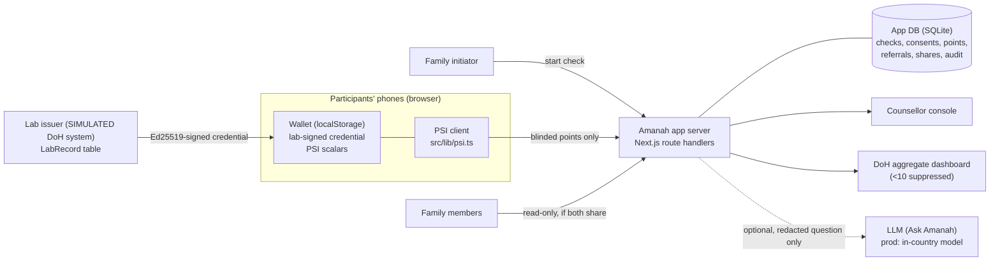
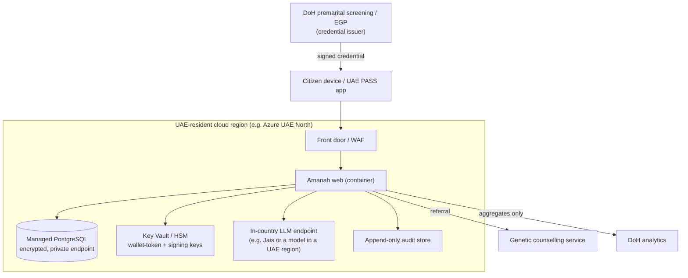

# Architecture

## 1. System context



**Trust boundaries.** Plaintext carrier genes exist only in (a) the simulated lab system (`LabRecord`, `src/server/lab-issuer.ts`) and (b) each participant's own device wallet. The app server and its tables hold blinded points, booleans and condition IDs (after joint consent). A test (`tests/checks.test.ts`) and the live transparency view (`/checks/[id]/server`) scan every table except `LabRecord` for gene symbols.

## 2. Components

| Area | Files |
|---|---|
| PSI protocol | `src/lib/psi.ts` (pure, runs in browser and in tests) |
| Lab issuer (simulated) + credentials | `src/server/lab-issuer.ts`, `src/lib/credential.ts`, `src/server/secrets.ts`, `/api/lab/*` |
| Wallet + background agent | `src/lib/wallet.ts`, `src/components/wallet-agent.tsx`, `/api/wallet/*` (device-token auth) |
| Check lifecycle / consent state machine | `src/server/checks.ts`, `src/server/views.ts`, `/api/checks/*` |
| Trusted fallback matcher | `src/server/trusted-matcher.ts` (`MATCHING_MODE=trusted`) |
| Audit log (hash chain) | `src/server/audit.ts`, `/api/audit` |
| Referrals, triage, SLA | `src/server/referrals.ts`, `src/lib/triage.ts`, `/api/referrals/*` |
| Family sharing | `src/server/shares.ts`, `/api/shares/*`, `/api/family` |
| Aggregates | `src/server/metrics.ts`, `/dashboard` |
| Ask Amanah | `src/lib/ask-rules.ts`, `src/server/ask.ts`, `src/server/ask-prompt.ts`, `content/faq.json` |
| Content | `content/conditions.json`, `src/i18n/{en,ar}.ts` |
| RBAC | `src/middleware.ts` (coarse gate) + `requireUser(...roles)` / `pageCtx(...roles)` per handler/page |

## 3. PSI sequence (semi-honest DH PSI-cardinality over ristretto255)

`H(g) = hashToRistretto255("AMANAH-v1|" + checkId + "|" + geneId)`, `PAD = 48`.

```mermaid
sequenceDiagram
  autonumber
  participant P1 as P1 device (first to accept)
  participant S as Amanah server
  participant P2 as P2 device (second to accept)
  P1->>P1: a ← random scalar; X = shuffle(pad₄₈({H(g)·a}))
  P1->>S: consent ACCEPTED + X (48 points)
  Note over P1: wallet keeps a + index→gene map
  P2->>S: fetch X
  P2->>P2: b ← random; Y = shuffle({x·b}); Z = shuffle(pad₄₈({H(g)·b}))
  P2->>S: consent ACCEPTED + Y, Z
  S->>S: status COMPUTING
  P1->>S: (wallet agent poll) fetch Y, Z
  P1->>P1: Z' = {z·a}; count = |Y ∩ Z'| (never sent)
  P1->>S: sharedRisk = count > 0
  S-->>P1: result (both participants only)
  S-->>P2: result
  rect rgba(15,118,110,0.08)
  Note over P1,P2: Stage 2 — only if BOTH tap "Show which condition"
  P2->>S: Y_ordered = {x·b} in X's original order
  P1->>P1: match Y_ordered[i] ∈ Z' → gene via index map → condition id
  P1->>S: condition id(s)
  end
  Note over P1,P2: scalars deleted from wallets when the check closes / after the Stage 2 decision
```

**Leakage.** Neither party learns the other's gene list. P1's client technically learns the intersection size; the UI shows only the boolean. Fixed padding hides list lengths. Different `checkId`s make points unlinkable across checks. The model is **semi-honest**: a malicious participant could lie or probe, which is mitigated by mutual consent, rate limits (3 checks per 30 days per person and per initiator) and audit logging. For production, use threshold or circuit PSI, or a DoH-run secure enclave, so that only the boolean is revealed.

**Demo note.** One browser simulates every participant's phone. Each wallet authenticates its PSI steps with its own device token (HMAC), so the background `WalletAgent` can run P1's step even while another persona is signed in.

**Fallback.** `MATCHING_MODE=trusted` keeps the same API and state machine. After both consents, an isolated module reads the simulated lab system and persists only the boolean (and, after joint reveal consent, condition IDs).

## 4. Consent state machine

```mermaid
stateDiagram-v2
  [*] --> AWAITING_CONSENT: initiator creates (rate-limited)
  AWAITING_CONSENT --> COMPUTING: both MATCH consents ACCEPTED (psi)
  AWAITING_CONSENT --> COMPLETE: both ACCEPTED (trusted mode)
  COMPUTING --> COMPLETE: P1 wallet posts boolean
  AWAITING_CONSENT --> EXPIRED: expiresAt passes (7 days; 3 min with DEMO_FAST)
  COMPUTING --> EXPIRED: expiresAt passes
  note right of AWAITING_CONSENT
    DECLINED / WITHDRAWN are stored only on the
    Consent row and never change Check.status.
    Requester and other participant see "Waiting",
    then "Check could not be completed": identical
    to a timeout.
  end note
  COMPLETE --> COMPLETE: Stage 2 reveal (both REVEAL consents)
```



`publicStatus()` in `src/server/checks.ts` depends only on `Check.status`. The requester view (`src/server/views.ts`) never includes consent decisions. The participant view never includes the other person's decision.

## 5. Deployment view (target)



The prototype runs as one container with SQLite (`Dockerfile`). For production: Postgres, keys in HSM / Key Vault, the lab signing key held by the DoH issuer (not the app), and an **in-country hosted model** for Ask Amanah to meet health-data localisation rules (UAE Federal Law No. 2 of 2019). The current prototype can call the Anthropic API only when `ANTHROPIC_API_KEY` is set, and only with the redacted question, UI language, FAQ and generic condition card.

## 6. Integration points (all mocked)

| Integration | Prototype | Production intent |
|---|---|---|
| UAE PASS login | Persona switcher ("Demo mode") | OIDC with UAE PASS; participant identity bound to the wallet |
| TAMM-style notifications (SMS/WhatsApp) | In-app inbox + "Demo — nothing sent" preview card; 3 s polling | Government notification gateway; content-free messages ("you have a private message") |
| DoH premarital screening results / Emirati Genome Programme | `lab-issuer` simulation signing Ed25519 credentials | DoH issues verifiable credentials directly to the citizen's device |
| Malaffi (HIE) | Not connected | Optional: counsellor letter to the treating clinician, only with explicit consent |
| Genetic counselling service | Counsellor console in-app | Referral feed into DoH/Malaffi-connected counselling services, with tele-counselling |
